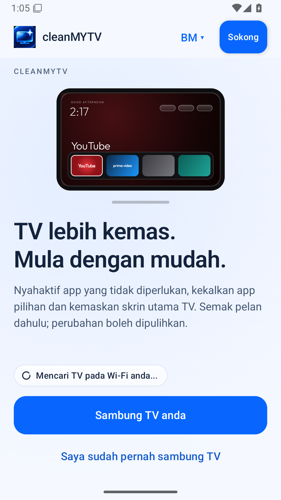
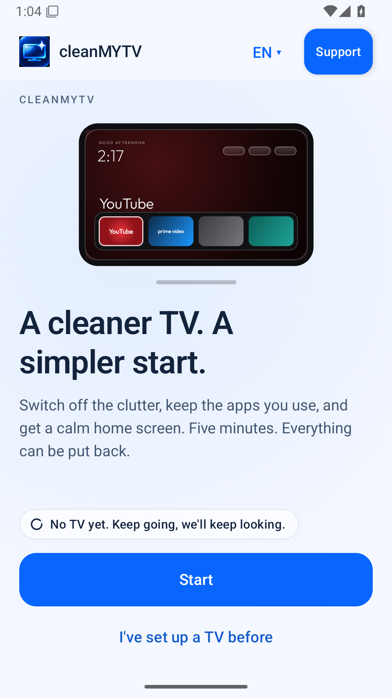
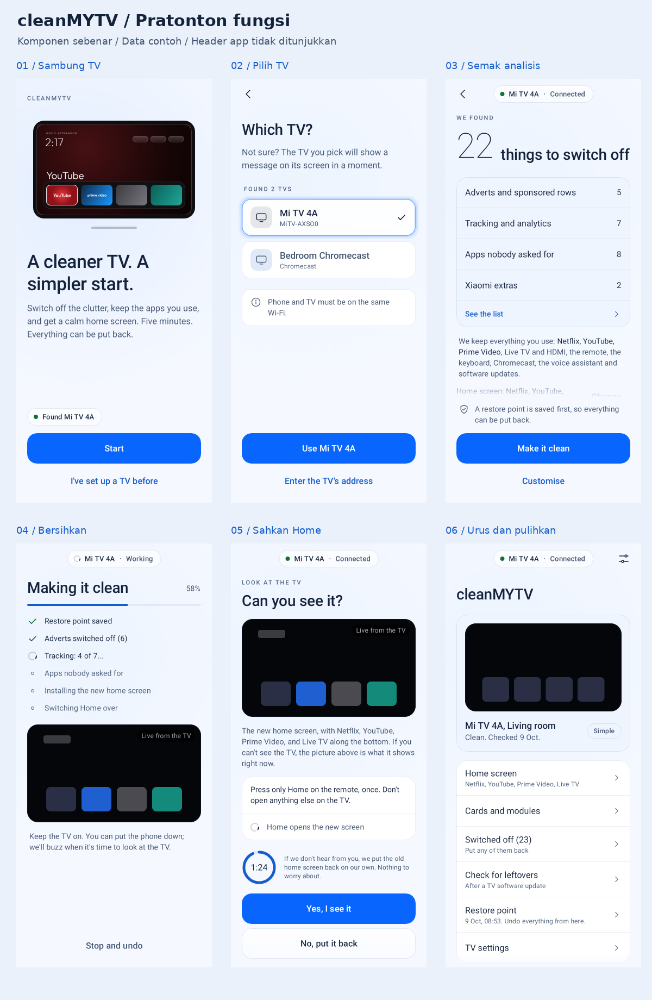

# cleanMYTV · 1.2.0 beta

[Bahasa Melayu](#bahasa-melayu) · [English](#english) · [Muat turun APK](https://github.com/AmexSaad/cleanMYTV/releases/download/v1.2.0-beta1/cleanMYTV.apk) · [Sokong projek](https://sociabuzz.com/cleanmytv/tribe)

## Bahasa Melayu

Versi ini menggunakan sumber **Clean Your TV v0.4.6-beta2** sebagai asas fungsi, dengan reka bentuk cleanMYTV putih dan biru serta pilihan Bahasa Melayu / English.

1. Pasang `cleanMYTV.apk` pada **telefon Android 9 atau lebih baharu**. Telefon dan Android TV mesti berada dalam rangkaian yang sama.
2. Sambung TV melalui carian automatik atau alamat TV. Ikut panduan debugging dan benarkan telefon pada TV.
3. Semak hasil analisis dan pelan perubahan sebelum meneruskan. Pembersihan menyahaktif app; pakej sistem tidak dipadam.
4. Pilihan skrin utama, susunan app, gaya, pemulihan dan laporan menggunakan aliran rujukan. Custom MyLauncher versi cleanMYTV lama telah digantikan dengan aliran skrin utama rujukan.

**[📥 Muat turun cleanMYTV.apk](https://github.com/AmexSaad/cleanMYTV/releases/download/v1.2.0-beta1/cleanMYTV.apk)** · [Nota keluaran](https://github.com/AmexSaad/cleanMYTV/releases/tag/v1.2.0-beta1)

Fail APK boleh dipasang terus, tanpa ekstrak ZIP. Ini ialah beta debug, bukan keluaran Play Store. Pautan Drive versi lama bukan binaan versi ini.

Rekod cleanMYTV 1.1 disimpan pada telefon tetapi tidak diimport ke jurnal baharu. Pulihkan perubahan TV menggunakan versi lama dahulu sebelum menggantikan app, jika rekod itu masih diperlukan. Android mungkin menolak kemas kini jika tandatangan binaan debug berbeza; jangan nyahpasang versi lama sebelum menyelesaikan pemulihan yang diperlukan. Versi ini menaikkan keperluan telefon daripada Android 8 kepada Android 9 mengikut sumber rujukan. Keserasian dan sekatan firmware bergantung pada TV. Ujian automatik tidak menggantikan pengesahan pada TV fizikal.

## English

This version uses **Clean Your TV v0.4.6-beta2** as its functional foundation, with cleanMYTV's white/blue interface and Malay/English selection. It retains the reference connection, discovery, analysis, plan review, cleaning, home-screen setup, layout, restore, backup, add-on and report flows.

[Download cleanMYTV.apk directly](https://github.com/AmexSaad/cleanMYTV/releases/download/v1.2.0-beta1/cleanMYTV.apk) for an **Android 9+ phone**. Keep the phone and Android TV on the same network, follow the debugging instructions, authorize the phone on the TV, and review the plan before applying changes. System packages are disabled rather than uninstalled. The reference's home confirmation and recovery guards remain in place.

This is a beta debug build. The previous custom MyLauncher is replaced by the reference home-screen flow. Legacy cleanMYTV records remain on disk but are not imported into the new journal; restore any needed TV changes with the old app before replacing it. Debug signing certificates can differ between builds, so Android may reject an in-place update; finish any needed recovery before uninstalling the old app. Previous Google Drive builds are not this version. Physical TV and firmware compatibility still require device testing.

## Paparan / Screenshots

Paparan app yang dipasang pada emulator Android 15 / Installed app on an Android 15 emulator:

| Bahasa Melayu | English |
|---|---|
|  |  |

Aliran utama dengan data contoh / Main flow with sample data:



## Build

JDK 21, Android SDK 37, the checked-in Gradle wrapper, and the pinned Git submodule are required:

```sh
git submodule update --init --recursive
./gradlew :app:assembleFullDebug
```

## Source and credits

Derived from [udhaykumarbala/cleanyourtv-app](https://github.com/udhaykumarbala/cleanyourtv-app), tag `v0.4.6-beta2`, commit `0413da3068c563d8325f14f782209927f9783e1d`, under its MIT licence. Original copyright, licence, bundled-asset attribution and third-party notices are retained. The reference TV launcher is pinned through the original submodule. See [upstream documentation](README.upstream.md) for architecture and the full original documentation. cleanMYTV is a separate derivative project; no official affiliation is claimed.
