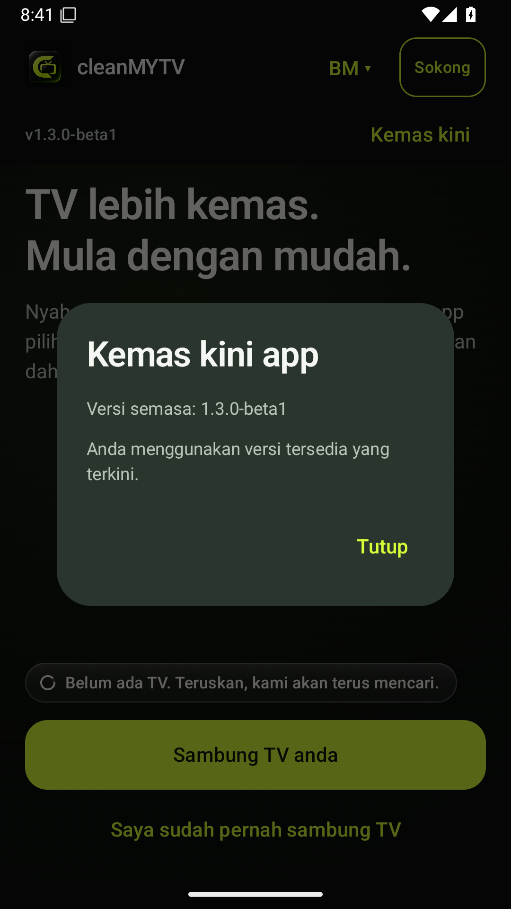
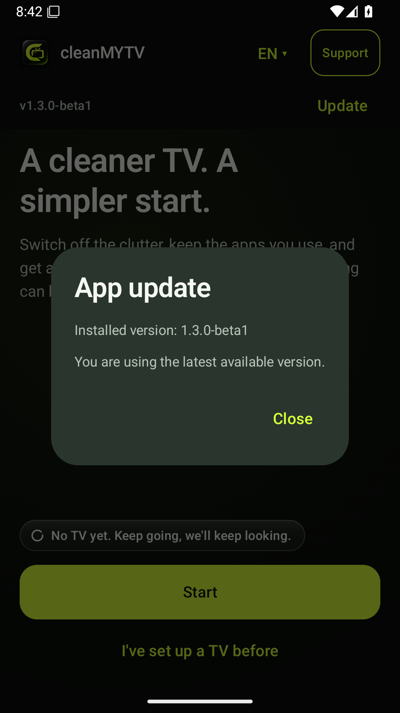

# cleanMYTV · 1.3.0 beta


[Bahasa Melayu](#bahasa-melayu) · [English](#english) · [Muat turun APK](https://github.com/AmexSaad/cleanMYTV/releases/download/v1.3.0-beta1/cleanMYTV.apk) · [Sokong projek](https://sociabuzz.com/cleanmytv/tribe)

## Bahasa Melayu

Versi ini menggunakan sumber **Clean Your TV v0.4.6-beta2** sebagai asas fungsi, dengan reka bentuk cleanMYTV Hitam + Limau serta pilihan Bahasa Melayu / English. Logo 03 Monogram digunakan pada ikon telefon dan dalam app; fungsi sedia ada dikekalkan.

1. Pasang `cleanMYTV.apk` pada **telefon Android 9 atau lebih baharu**. Telefon dan Android TV mesti berada dalam rangkaian yang sama.
2. Sambung TV melalui carian automatik atau alamat TV. Ikut panduan debugging dan benarkan telefon pada TV.
3. Semak hasil analisis dan pelan perubahan sebelum meneruskan. Pembersihan menyahaktif app; pakej sistem tidak dipadam.
4. Pilihan skrin utama, susunan app, gaya, pemulihan dan laporan menggunakan aliran rujukan. Custom MyLauncher versi cleanMYTV lama telah digantikan dengan aliran skrin utama rujukan.

**[📥 Muat turun cleanMYTV.apk](https://github.com/AmexSaad/cleanMYTV/releases/download/v1.3.0-beta1/cleanMYTV.apk)** · [Nota keluaran](https://github.com/AmexSaad/cleanMYTV/releases/tag/v1.3.0-beta1)

Fail APK boleh dipasang terus, tanpa ekstrak ZIP. Ini ialah beta dengan tandatangan release tetap, bukan keluaran Play Store. Pautan Drive versi lama bukan binaan versi ini.

**Kemas kini app:** Tekan **Kemas kini** di bawah logo. App menyemak keluaran GitHub termasuk beta, memaparkan versi dan nota perubahan, kemudian menawarkan **Muat turun APK**. Buka fail itu dan sahkan pemasangan Android. Muat turun dihalang ketika operasi TV belum selesai.

Keluaran ini memulakan tandatangan release tetap. Beta debug 1.2.x terdahulu memerlukan pemasangan semula sekali: selesaikan pemulihan TV yang diperlukan menggunakan app lama sebelum menyahpasangnya. Kemas kini seterusnya yang menggunakan kunci sama boleh dipasang terus. Rekod cleanMYTV 1.1 tidak diimport ke jurnal baharu. Keserasian firmware masih memerlukan pengesahan pada TV fizikal.

## English

This version uses **Clean Your TV v0.4.6-beta2** as its functional foundation, with cleanMYTV's graphite/lime interface and Malay/English selection. Monogram 03 is used on the phone launcher icon and inside the app, with existing functions retained. It retains the reference connection, discovery, analysis, plan review, cleaning, home-screen setup, layout, restore, backup, add-on and report flows.

[Download cleanMYTV.apk directly](https://github.com/AmexSaad/cleanMYTV/releases/download/v1.3.0-beta1/cleanMYTV.apk) for an **Android 9+ phone**. Keep the phone and Android TV on the same network, follow the debugging instructions, authorize the phone on the TV, and review the plan before applying changes. System packages are disabled rather than uninstalled. The reference's home confirmation and recovery guards remain in place.

**Update the app:** Tap **Update** below the logo to check GitHub releases, including betas, read the changes and download the repository APK. Open the downloaded file and confirm Android installation. Downloads are blocked during unfinished TV operations.

This beta starts a permanent release signing identity. Earlier 1.2.x debug betas require a one-time reinstall after completing any needed TV recovery with the old app. Future releases using this same key can update in place. Legacy 1.1 records are not imported into the new journal. This is not a Play Store release; physical TV and firmware compatibility still require device testing. See [update and signing details](UPDATES.md).

[Pengesahan binaan / Build validation](https://github.com/AmexSaad/cleanMYTV/actions/runs/41026165604): 1,133 ujian lulus; pemasangan kemas kini tanpa nyahpasang mengekalkan pilihan bahasa; paparan BM/EN, dialog kemas kini dan ikon Android dirakam pada emulator Android 15. / 1,133 tests passed; a same-key in-place upgrade retained the language setting, with BM/EN screens, update dialogs and the launcher icon captured on an Android 15 emulator.

## Paparan / Screenshots

Paparan app yang dipasang pada emulator Android 15 / Installed app on an Android 15 emulator:

| Bahasa Melayu | English |
|---|---|
|  |  |

Butang dan dialog kemas kini / Update control and dialog:

| Bahasa Melayu | English |
|---|---|
|  |  |

Aliran utama dengan data contoh / Main flow with sample data:


## Build

JDK 21, Android SDK 37, the checked-in Gradle wrapper, and the pinned Git submodule are required:

```sh
git submodule update --init --recursive
./gradlew :app:assembleFullDebug
```

## Source and credits

Derived from [udhaykumarbala/cleanyourtv-app](https://github.com/udhaykumarbala/cleanyourtv-app), tag `v0.4.6-beta2`, commit `0413da3068c563d8325f14f782209927f9783e1d`, under its MIT licence. Original copyright, licence, bundled-asset attribution and third-party notices are retained. The reference TV launcher is pinned through the original submodule. See [upstream documentation](README.upstream.md) for architecture and the full original documentation. cleanMYTV is a separate derivative project; no official affiliation is claimed.
