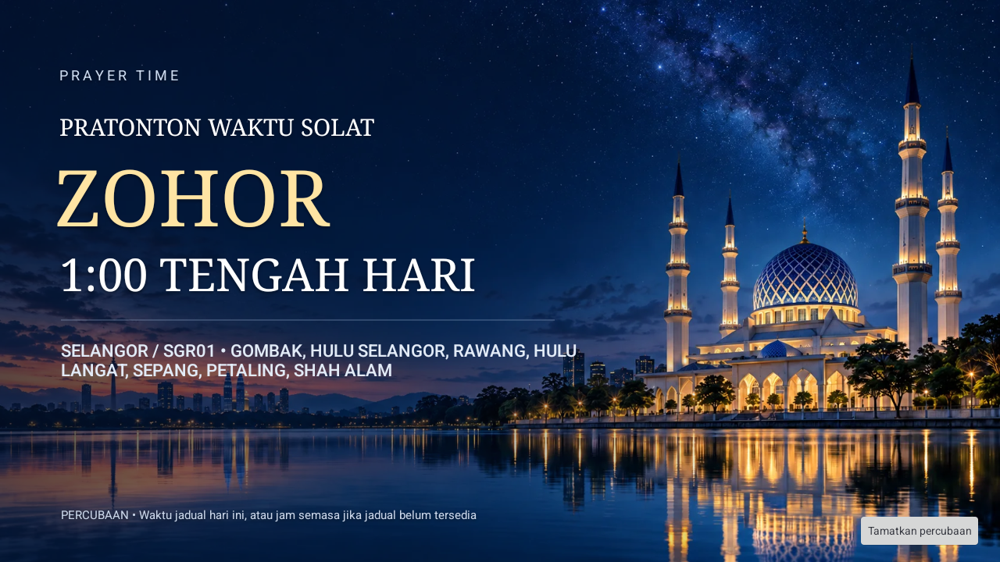
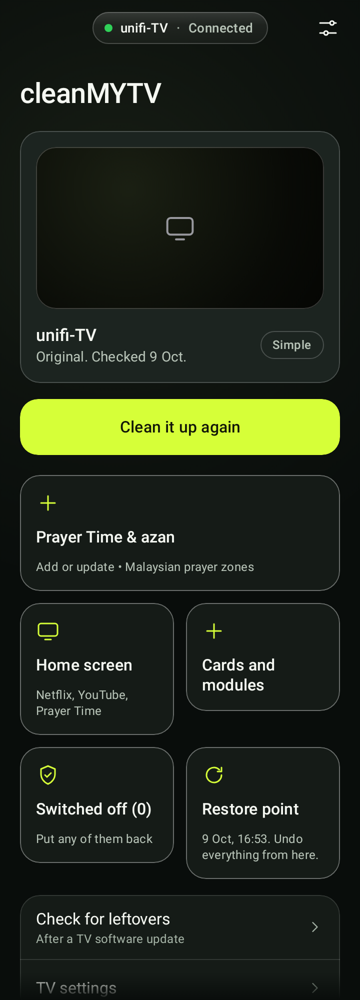

# Prayer Time — poster azan dinamik

Reka bentuk dipilih pengguna: nombor 2, masjid biru malam. Gambar latar tidak mengandungi tulisan. `PrayerPoster` melukis nama solat, waktu **event penggera yang disahkan** dalam waktu Malaysia, serta kawasan/zon pilihan pengguna. Waktu telefon atau jam semasa tidak menggantikan waktu penggera sebenar.

Latar `prayer_night.webp` sekitar 180 KB dibungkus sekali. Tiada video, YouTube, hosting, iklan, cache video atau muat turun gambar. MediaPlayer sedia ada memainkan audio Subuh berasingan; empat waktu lain menggunakan audio biasa. Popup dilepaskan apabila audio tamat, dihentikan melalui notifikasi, atau pemasa kecemasan 10 minit tamat.

Percubaan dilabel **PRATONTON WAKTU SOLAT**, menggunakan jadual hari ini jika ada. Tanpa jadual, percubaan sahaja menggunakan jam semasa dan menerangkan perkara itu pada skrin. Percubaan tidak menghidupkan azan automatik atau pilihan paparan penuh secara kekal. Kebenaran overlay diperlukan.

Teks lokasi panjang dibalut sehingga tiga baris, dengan elipsis jika masih terlalu panjang. Deskripsi aksesibiliti menyimpan lokasi penuh. Nama waktu, jam dan kawasan bukan sebahagian daripada fail gambar.

## Cara guna

1. Kemas kini app telefon cleanMYTV.
2. Pada dashboard telefon, tekan **Prayer Time & azan**, kemudian **Tambah** atau **Kemas kini Prayer Time**.
3. Buka **Prayer Time** pada TV; pilih negeri dan zon Malaysia.
4. Hidupkan azan dan paparan penuh jika mahu; beri kebenaran yang diminta.
5. Tekan **Cuba poster & azan • pilih waktu**. Pilih Subuh/Zohor/Asar/Maghrib/Isyak. Butang tamatkan percubaan tersedia.

## Pratonton

## Asal reka bentuk

Latar ilustrasi dijana dengan built-in imagegen berdasarkan poster pilihan pengguna. Ia bukan dokumentasi foto lokasi atau masjid tertentu.

Prompt edit: “Remove ALL text, letters, time, location, headline, footer and thin decorative rules. Seamlessly reconstruct the underlying midnight blue starry sky and water. Preserve the composition, mosque on the right, skyline, reflections, colors and landscape 16:9 framing. Keep the left 60% calm dark blue for dynamic Android text. No text or new objects.” Dikompres kepada WebP untuk aset Android. Tiada perkhidmatan AI dipanggil semasa app digunakan.
