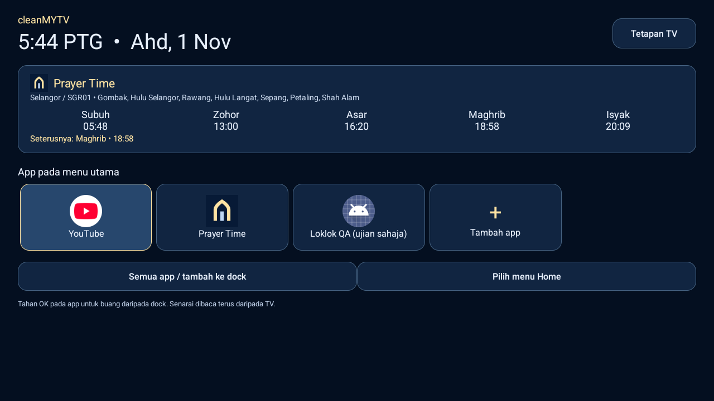
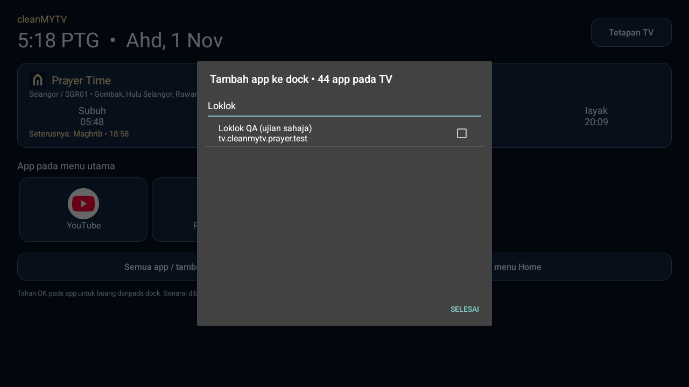

# Menu TV & Prayer Time

## Penting: aktifkan menu baharu sekali

Kemas kini app telefon sahaja tidak menukar launcher yang sedang dilukis pada TV.

1. Pada app telefon, tekan **Update / Kemas kini** dan pasang **1.3.0-beta4**.
2. Buka **Menu TV & Prayer Time** pada dashboard telefon. Tekan **Kemas kini menu TV & Prayer Time** (atau Tambah jika belum dipasang).
3. Menu baharu dibuka pada TV selepas modul dihantar. Tekan **Aktifkan menu ini** atau **Pilih menu Home**.
4. Dalam tetapan Home Android, pilih **Prayer Time**. Sahkan **Change / Tukar** jika diminta.
5. Tekan butang Home pada remote. Kini menu ini memaparkan **+ Tambah app**, **widget waktu solat** dan **ikon Prayer Time**.

Pilihan Home lama kekal dipasang. Untuk kembali, pilih launcher lama dalam tetapan Home Android. Pemilihan ini menggunakan tetapan Android biasa; tiada pemadaman launcher atau pertukaran default secara senyap.

## Screenshot menu sebenar

App **Loklok QA (ujian sahaja)** dalam screenshot ialah app ujian sumber terbuka dalam `src/androidTest`, dengan kategori LAUNCHER sahaja, tanpa LEANBACK_LAUNCHER. Ia bukan APK Loklok sebenar. Ujian membuktikan laluan app Android biasa boleh dicari dengan nama, dipin, dibuka menggunakan D-pad/OK dan kekal selepas Home serta naik taraf modul.

## Tambah app dan urus dock

Tekan tile **+ Tambah app** terus dalam dock. Cari nama app (contoh Loklok) atau nama pakej, tandakan app dan tekan **Selesai**. Senarai dibaca terus daripada box dan disegarkan selepas pemasangan/perubahan app. Tahan OK pada pintasan untuk membuangnya dari dock; app kekal dipasang. App perlu dipasang untuk pengguna Android semasa dan mempunyai activity MAIN yang dihidupkan serta boleh dibuka.

Menu menyokong dock, bilangan lajur dan gambar yang dihantar telefon. Pilihan dock pada box disimpan dalam modul. Menghantar gambar semula dengan senarai dock yang sama tidak membuang pilihan tambahan pada box. Launcher upstream lama masih tersedia untuk gaya/fiturnya sendiri; menu ini ialah Home baharu yang dinyatakan secara jelas.

## Widget dan azan

Tekan widget/ikon **Prayer Time** untuk pilih negeri dan zon Malaysia. Jadual disimpan dalam modul dan dipaparkan terus pada Home; paparan dikemas kini setiap minit ketika Home kelihatan. Tanpa jadual hari ini, widget meminta pengguna memuatkan jadual dan tidak menganggarkan waktu. Pembukaan Home menyusun semula penggera; jika jadual hari ini tiada, cubaan muat semula latar dibuat sekali sehari untuk zon itu. Muat semula manual sentiasa tersedia dalam tetapan Prayer Time.

Audio dan paparan penuh ialah pilihan pengguna. Audio Subuh berasingan disertakan. Poster azan nombor 2 menggunakan nama solat, waktu jadual dan kawasan dinamik. Tiada video atau iklan.

Pada emulator, app QA menjadi activity di belakang tetapi hanya poster azan kelihatan selepas Home/Back dan pembukaan app tersebut. Selepas rakaman tamat, service/popup hilang dan app QA kelihatan semula. Kawalan hentikan percubaan dan hentikan melalui notifikasi masih tersedia. Ini bukan janji semua butang sistem/firmware boleh dikunci; tiada akses fizikal kepada box pengguna dalam sesi ujian ini.

## Identiti dan pemulihan

Modul ialah pakej `tv.cleanmytv.prayer`, kod versi 3, versi `2.0-beta1`, dengan sijil asal modul. Tiada keperluan menyahpasang versi lama. Kod Home tidak menggunakan kunci launcher upstream yang tidak dimiliki projek. Pengguna memilih Prayer Time sebagai Home melalui Android. Konfigurasi telefon hanya dihantar ke Home alternatif yang tepat dan sepadan dengan signer terpinkan; laluan fail tambahan ialah folder external-files modul sahaja. Kemaskini dock tidak mematikan service azan dengan force-stop. Mengeluarkan modul yang masih menjadi default Home ditolak.

Lihat [bukti ujian terperinci](../../previews/TV-HOME-VALIDATION.md), [RFC](../../docs/RFC-CLEANMYTV-HOME.md) dan [catatan kemas kini](../../CHANGELOG.md).
